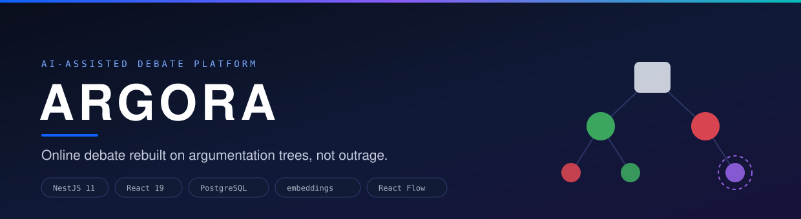
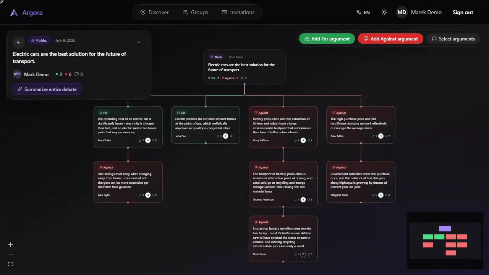
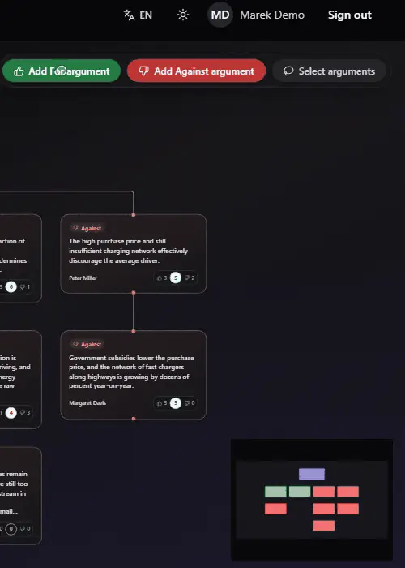
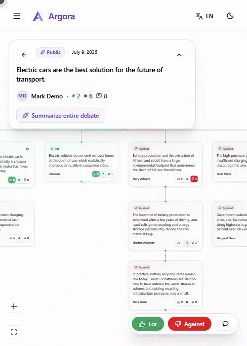
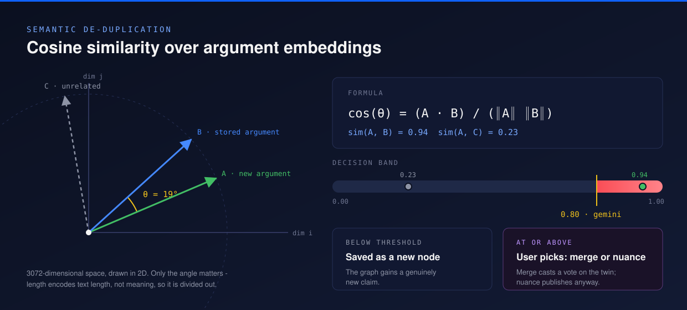
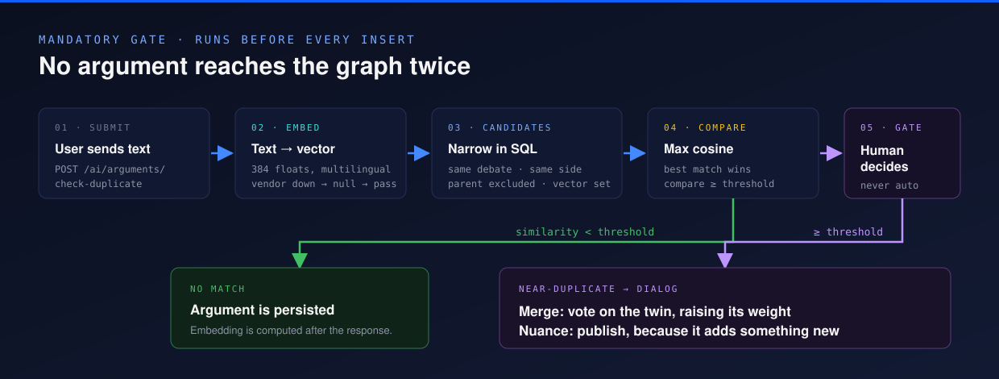
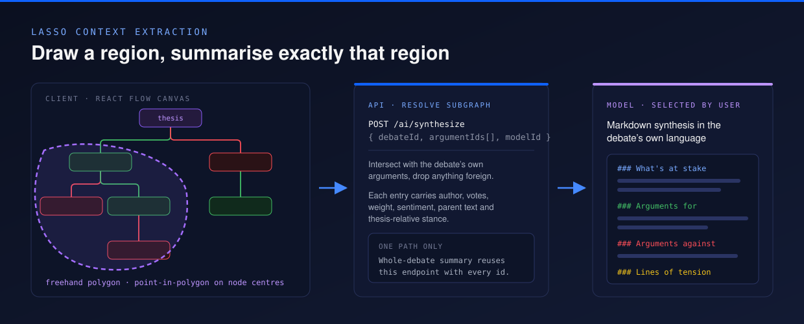
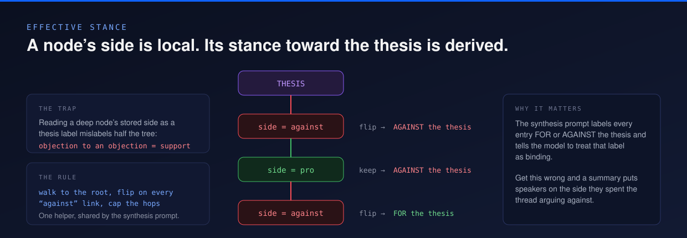
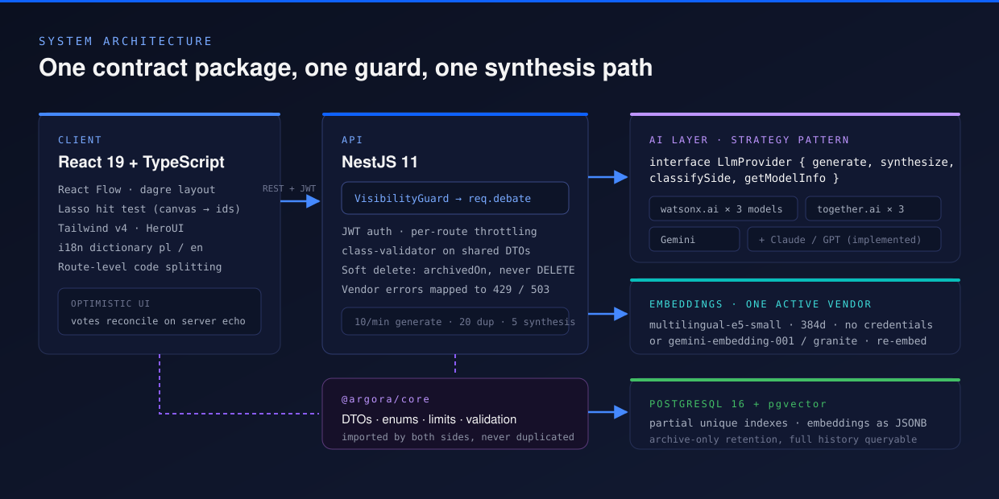
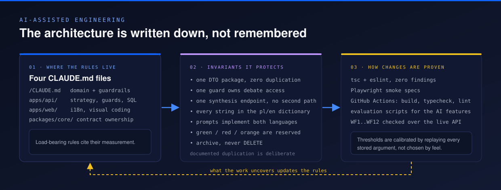

<p align="center">
  
</p>

<p align="center">
  
  
  
  
  
</p>

<p align="center">
  <a href="https://youtu.be/Fgw38GYoWFg"><b>Video walkthrough</b></a> &nbsp;·&nbsp;
  <a href="#how-the-ai-works"><b>How the AI works</b></a> &nbsp;·&nbsp;
  <a href="#architecture"><b>Architecture</b></a> &nbsp;·&nbsp;
  <a href="#architecture-constraints"><b>Architecture constraints</b></a> &nbsp;·&nbsp;
  <a href="#run-it-locally"><b>Run it locally</b></a>
</p>

---

## The problem this solves

A comment thread is a **timeline**. It rewards whoever posts most often and most loudly, it forgets what was already said, and after two hundred replies nobody can tell you what the disagreement actually is.

Argora replaces the timeline with a **tree**. Every claim is attached to the claim it answers, so the shape of the discussion means something: a deep branch shows where the disagreement is sharpest, and a claim with no replies marks an objection nobody answered. Three AI features are built on that structure: semantic de-duplication, synthesis of a selected region, and context-aware generation.

> Built as the practical part of an MSc thesis, and presented at the **IBM Innovation Project - Country Challenge 2026**. <br>A [video walkthrough](https://youtu.be/Fgw38GYoWFg) shows the running application end to end.

---

## See it

<p align="center">
  
</p>

<table>
<tr>
<td width="50%"></td>
<td width="50%"></td>
</tr>
<tr>
<td><b>Drafting with a model.</b> Pick a side, pick a vendor, and the generated text appears in the field as a proposal - nothing is published until a person accepts it.</td>
<td><b>Duplicate gate.</b> A near-identical claim is caught before it is saved, and the author decides what happens next.</td>
</tr>
</table>

---

## How the AI works

### 1. Semantic de-duplication

Two people routinely submit the same claim in different words, and keyword matching cannot catch it: _"commuting eats hours of my week"_ and _"remote work gives people their time back"_ share no words and mean the same thing.

Every argument is converted into a vector by a multilingual model, and similarity is measured as the **cosine of the angle** between two vectors. The length of a vector reflects how long the text is, not what it means, so the formula divides that length out.

<p align="center">
  
</p>

```ts
// apps/api/src/ai/embedding.service.ts
cosineSimilarity(a: number[], b: number[]): number {
  let dot = 0;
  let normA = 0;
  let normB = 0;
  for (let i = 0; i < a.length; i++) {
    dot += a[i] * b[i];
    normA += a[i] * a[i];
    normB += b[i] * b[i];
  }
  if (normA === 0 || normB === 0) return 0;
  return dot / (Math.sqrt(normA) * Math.sqrt(normB));
}
```

The threshold belongs to the embedding model, not to the subject being debated, so each provider has its own value instead of sharing one global constant. Each value was calibrated by replaying every stored argument as if it were being submitted now, and counting how often the gate reported a match between arguments that are known to be different claims:

| embedding model                 | dims | non-duplicates (median) | threshold | submissions falsely flagged |
| ------------------------------- | ---- | ----------------------- | --------- | --------------------------- |
| `gemini-embedding-001`          | 3072 | 0.618                   | **0.80**  | 6.0%                        |
| `multilingual-e5-small` (local) | 384  | 0.834                   | **0.91**  | 4.6%                        |

Gemini scores unrelated arguments around 0.618 and the small local model around 0.834. The local model therefore leaves much less of the range for real duplicates, which is why its threshold is higher.

Each threshold is set from the last column, not from the per-pair rate. The gate compares a new argument against every candidate and keeps the **highest** score, so the rate measured per submission is several times higher than the rate measured per pair. These thresholds cannot be swapped: using Gemini's 0.80 with the local model falsely flags all **153 of 153** submissions. Each provider therefore has its own default threshold, and `DUPLICATE_THRESHOLD` only overrides it during testing.

The local model is what keeps the gate working after a fresh clone with an empty `.env`: it runs inside the API process through ONNX Runtime and needs no API key. `scripts/eval-duplicate-detection.mjs` re-runs the evaluation on the labelled set and reports both models.

<p align="center">
  
</p>

Beyond the formula:

- **The comparison set is narrowed in SQL**, so the database returns only the rows that can match, instead of the API loading every argument and filtering them in JavaScript. A row qualifies if it is in the same debate, on the same stored side, and already has an embedding. The parent of the new argument is excluded, because a reply repeats the wording of what it answers and would otherwise be flagged every time.
- **A failing embedding provider must not block the user.** `EmbeddingService.embed` returns `null` when the call fails, the check reports no similarity, and the argument is saved.
- **The gate never decides on its own.** Above the threshold the user sees both texts and chooses: _merge_ casts a vote that raises the existing argument's weight, _nuance_ publishes the new argument anyway.
- **Embeddings are computed after the response is sent.** Saving stays fast, and the vector is written a moment later.

### 2. Lasso context extraction

A summary of the whole debate merges every branch into one answer, but the question is often about a single branch.

<p align="center">
  
</p>

The client decides which nodes fall inside the lasso, using React Flow canvas coordinates. The API receives **ids only** and keeps the ones that belong to the debate, discarding anything else. Each selected node is passed to the model together with its author, vote counts, weight, sentiment, parent text and stance towards the thesis, so the model can see how the nodes relate without the prompt having to nest them.

Summarising a whole debate calls the same endpoint with every id passed in. There is one synthesis path, so there is no second implementation that could diverge from it.

### 3. Generation, and the stance problem

Generated text appears as a **proposal in the textarea**. It is marked as model output only when it really came from a model, and that mark is removed as soon as the argument is sent. Before publishing, a second model call checks the argument against the side the author picked, and offers to switch sides if the two do not match. If every provider fails, the argument is submitted anyway.

<p align="center">
  
</p>

A node's stored `side` is relative to its **immediate parent**. If it is read as a label relative to the thesis instead, an objection to an objection is recorded as opposition to the thesis, which puts speakers on the side they spent the whole thread arguing against. One helper walks up the chain of parents and reverses the stance on every _against_ link. The synthesis prompt uses that helper and tells the model to treat the resulting label as binding.

---

## Architecture

<p align="center">
  
</p>

### Design decisions

| Decision                                                | Why it is this way                                                                                                                                                                                                                                                                                  |
| ------------------------------------------------------- | --------------------------------------------------------------------------------------------------------------------------------------------------------------------------------------------------------------------------------------------------------------------------------------------------- |
| **Contracts are defined in `@argora/core`**             | Every DTO, enum and limit is declared once and imported by both sides. The minimum and maximum argument lengths are exported constants, so the form check, the server validator and the error message cannot disagree.                                                                              |
| **One `VisibilityGuard` for every debate-scoped route** | It resolves the debate from the route parameter, from an `:argumentId`, or from the request body, then attaches that row to the request. Services read `req.debate` instead of loading the debate and checking access again, because a rule written in two places eventually disagrees with itself. |
| **Provider-agnostic AI layer**                          | One `LlmProvider` interface, one class per vendor. The registry creates a provider for every vendor the environment has credentials for. An empty registry is a valid state to start in, and the AI features are simply unavailable.                                                                |
| **One active embedding vendor**                         | Vectors from different models cannot be compared, so the vendor is chosen once for the whole process rather than per request. Switching vendors means re-computing every stored embedding, and there is a script for that.                                                                          |
| **Archive, never delete**                               | Every table has an `archivedOn` column. Reads go through one `activeWhere` helper, and archiving a row also archives its children inside a single transaction. The full history stays available for analysis.                                                                                       |
| **Two partial unique indexes**                          | "One pending invitation per pair" and "one active vote per pair" are conditional constraints. A TypeORM `@Unique` cannot include a `WHERE` clause, so both are declared as partial unique `@Index` definitions on their entities and the database enforces them.                                    |
| **Per-route rate limits**                               | Each AI route uses one named rate limit and explicitly skips the other three, because a single shared guard would otherwise apply the strictest limit to all of them.                                                                                                                               |
| **Vendor errors are never shown raw**                   | Every provider call goes through one wrapper that turns rate-limit errors into 429 and everything else into 503, with a message written for the user instead of the text returned by the SDK.                                                                                                       |
| **The debate's language, not the reader's**             | A generated argument is saved as a node, so it must be in the same language as the tree it joins. Prompt builders take the debate's language, and a missing translation is a compile error rather than a silent fallback.                                                                           |

---

## Architecture constraints

<p align="center">
  
</p>

Four `CLAUDE.md` files act as a machine-readable architecture document: the root one holds the domain rules, and each workspace adds its own.

The codebase contains exactly one deliberate duplication: a sentiment constant copied to the client for optimistic UI. Both copies are marked with a comment.

---

## Run it locally

**Prerequisites:** Node ≥ 22, pnpm ≥ 10, Docker Desktop.

```bash
pnpm install
cp .env.example .env            # defaults work for local development
docker compose up -d            # PostgreSQL 16 + pgvector on :5432
pnpm --filter @argora/core build

pnpm dev:api                    # http://localhost:3000
pnpm dev:web                    # http://localhost:5173
```

Tables are created on first boot. AI features depend on which vendor is configured: add `IBM_CLOUD_API_KEY` + `WATSONX_PROJECT_ID` + `WATSONX_URL`, `TOGETHER_API_KEY`, or `GEMINI_API_KEY` to `.env` and the registry enables whichever of them are present. With no keys at all the app still runs: the model picker is simply empty, and duplicate detection keeps working on the local embedding model, which needs no credentials.

```bash
pnpm seed:nuclear:pl            # a 4-level Polish debate
pnpm seed:agi:en                # a large English debate
pnpm test:e2e                   # Playwright smoke suite
```

Full setup, test-database preparation and troubleshooting: **[docs/DEVELOPMENT.md](docs/DEVELOPMENT.md)**.

---

## Repository layout

```text
apps/
  api/          NestJS: auth, debates, arguments, votes, groups, AI
  web/          React 19 + Vite: graph canvas, panels, i18n dictionary
  e2e/          Playwright smoke specs
packages/
  core/         DTOs, enums, limits - the contract both apps import
scripts/        Seeding and evaluation scripts (plain Node, .mjs)
  lib/          Shared .env reader, HTTP client, domain mirrors, prompt copy
db/init.sql     pgvector extension (the partial unique indexes are
                declared on the entities)
docs/assets/    Diagrams and screenshots used by this README
```

---

## Roadmap

- **Richer relation language** beyond pro/against: _condition_, _example with a source_, _refinement of scope_.
- **Real-time collaboration** - several people shaping one graph at the same time.
- **Checking factual claims** made in a debate against retrieved sources.
- **Search using pgvector directly** - the extension is already enabled. A `vector` column has its dimension written into the column type, so moving embeddings out of `jsonb` would tie the schema to one embedding model.

---

Screenshots show the real interface with seeded demo data. Released under the [MIT licence](LICENSE).
